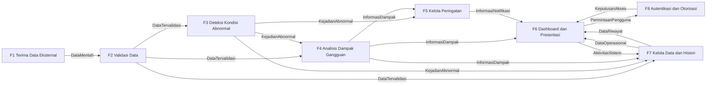
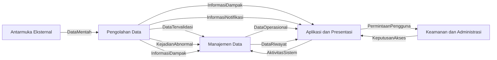

# RRTMS – Arsitektur System Composer

**Railway Real-Time Monitoring System (RRTMS)** adalah rancangan sistem monitoring lalu lintas kereta api secara real-time yang berfungsi sebagai **sistem pemantauan dan pendukung keputusan**. Repositori ini berisi model arsitektur sistem yang dibangun menggunakan **MATLAB Simulink** dan **System Composer**, sebagai lampiran dari dokumen *System Requirement Specification* RRTMS.

> **Batas sistem:** RRTMS hanya memantau, menganalisis, dan menyajikan informasi. RRTMS **tidak** mengendalikan gerak kereta, wesel, maupun sistem persinyalan. Status persinyalan diterima secara *read-only*.

---

## Latar Belakang

Operasi perkeretaapian melibatkan banyak perjalanan yang saling berkaitan. Tanpa penyajian informasi yang terintegrasi, operator kesulitan memperoleh gambaran kondisi terkini, mengenali anomali, dan memahami dampak gangguan terhadap kereta lain. RRTMS dirancang untuk:

1. Memantau posisi dan status perjalanan kereta secara real-time.
2. Menerima dan mengolah data dari sistem eksternal.
3. Mengidentifikasi kondisi abnormal berdasarkan aturan yang dikonfigurasi.
4. Menganalisis potensi dampak gangguan terhadap kereta lain.
5. Menyajikan peringatan dan informasi pendukung kepada operator.
6. Mencatat histori pemantauan dan kejadian untuk penelusuran dan audit.

---

## Isi Repositori

| File                              | Deskripsi                                                                                                  |
|-----------------------------------|------------------------------------------------------------------------------------------------------------|
| `RRTMS_Context_Diagram.slx`       | Context Diagram: hubungan RRTMS dengan entitas eksternal                                                   |
| `RRTMS_SD1_Monitoring.slx`        | Model Sequence Diagram 1: monitoring perjalanan (validasi data, umur data, deteksi *stale*, status kereta) |
| `RRTMS_SD2_Deteksi_Dampak.slx`    | Model Sequence Diagram 2: deteksi gangguan, severity, dan estimasi dampak keterlambatan                    |
| `RRTMS_Activity_State.slx`        | Model Activity/State: transisi state sistem berdasarkan kondisi input                                      |
| `RRTMS_Arsitektur_Fungsional.slx` | Functional Architecture: 8 fungsi (F1–F8) beserta aliran informasinya                                      |
| `RRTMS_Arsitektur Fisik.slx`      | Physical Architecture: 5 komponen logis beserta antarmukanya                                               |
| `RRTMS_Arsitektur Alokasi.mldatx` | Allocation Set: pemetaan fungsi ke komponen                                                                |
| `RRTMS_System_Architecture.slx`   | Model arsitektur sistem secara keseluruhan                                                                 |

---

## Ringkasan Arsitektur

### Functional Architecture (8 Fungsi)

| ID | Fungsi |
|----|--------|
| F1 | Terima Data Eksternal |
| F2 | Validasi Data |
| F3 | Deteksi Kondisi Abnormal |
| F4 | Analisis Dampak Gangguan |
| F5 | Kelola Peringatan |
| F6 | Dashboard dan Presentasi |
| F7 | Kelola Data dan Histori |
| F8 | Autentikasi dan Otorisasi |



### Physical Architecture (5 Komponen)



### Allocated Architecture (Function-to-Component)

| Fungsi | Komponen |
|--------|----------|
| F1 | Antarmuka Eksternal |
| F2, F3, F4, F5 | Pengolahan Data |
| F6 | Aplikasi dan Presentasi |
| F7 | Manajemen Data |
| F8 | Keamanan dan Administrasi |

---

## Entitas Eksternal

- Kereta / Onboard Monitoring System
- Pusat Kendali Kereta Api
- Sistem Persinyalan (*read-only*)
- Monitoring Infrastruktur Jalur
- Sistem Stasiun
- Tim Penanganan Gangguan

---

## System Requirements

RRTMS memiliki **30 requirement** (19 Functional Requirements dan 11 Non-Functional Requirements), dengan **9 requirement berprioritas Critical**. Beberapa contoh target kinerja (berstatus *Proposed* hingga divalidasi pihak operasional):

- Peringatan tampil ke operator ≤ 10 detik sejak data pemicu diterima (NFR-01)
- Dashboard diperbarui ≤ 5 detik sejak data tervalidasi (NFR-02)
- Mampu memantau minimal 100 kereta aktif bersamaan (NFR-03)
- Availability ≥ 99,5% per bulan (NFR-04)
- Data ditandai *stale* bila tidak diperbarui > 30 detik (NFR-05)
- Tidak ada jalur perintah kendali ke kereta, wesel, atau persinyalan (NFR-06)

Seluruh requirement ditelusuri melalui *Requirements Traceability Matrix* (Stakeholder Need → Requirement → Function → Component → Verification → Acceptance Criteria) pada dokumen laporan.

---

## Skenario Simulasi pada Model Simulink

| Model | Skenario | Hasil |
|-------|----------|-------|
| SD1 – Monitoring | Validasi ID, posisi, kecepatan, status; umur data > 30 detik dianggap *stale*; pembaruan dashboard tiap 5 detik | Validitas, indikator *stale*, status kereta, umur data |
| SD2 – Deteksi & Dampak | Gangguan terdeteksi jika indikator aktif atau berhenti ≥ 120 detik; severity 1–3; 4 kereta × 8 menit | Total estimasi keterlambatan 32 menit |
| Activity/State | Data tersedia, gangguan terdeteksi, analisis dampak tersedia, belum ada konfirmasi operator | State **Analisis Dampak** (kode state 4) |

---

## Prasyarat

- MATLAB dengan **Simulink** dan **System Composer**
- *(Isi dengan versi MATLAB yang kalian gunakan, misalnya R2024a)*

## Cara Menjalankan

1. Clone repositori ini:
   ```bash
   git clone https://github.com/afifahzuriah/RRTMS-Arsitektur-System-Composer.git
   ```
2. Buka MATLAB, lalu set folder repositori sebagai *Current Folder*.
3. Buka model, contohnya:
   ```matlab
   open_system('RRTMS_Arsitektur_Fungsional.slx')
   open_system('RRTMS_Arsitektur Fisik.slx')
   ```
4. Untuk melihat alokasi fungsi ke komponen, buka file `RRTMS_Arsitektur Alokasi.mldatx` melalui **Allocation Editor** (*Apps → System Composer → Allocation Editor*).
5. Untuk model simulasi (SD1, SD2, Activity/State), jalankan dengan tombol **Run** di Simulink dan lihat hasilnya pada blok *Display*.

> Beberapa nama file mengandung spasi. Gunakan tanda petik saat memanggilnya lewat command window MATLAB.

---

## Tim Penyusun

| Nama                          | NIM             |
|-------------------------------|-----------------|
| Afifah Zuriah Mindarini       | 245150301111001 |
| Rahel Adolfine Alche Budianto | 245150301111029 |
| Sheindy Afrilia Manurung      | 245150307111005 |
| Adinda Eka Suja Pertiwi       | 245150307111014 |

**Dosen Pengampu:** Sabriansyah Rizqika Akbar, S.T., M.Eng., Ph.D.

Fakultas Ilmu Komputer, Universitas Brawijaya – 2026

---

## Catatan

- Seluruh nilai threshold dan target numerik berstatus **Proposed** dan perlu divalidasi bersama stakeholder operasional.
- Protocol dan format pesan interface eksternal akan ditetapkan pada *Interface Control Document* (ICD) pada tahap desain rinci.
